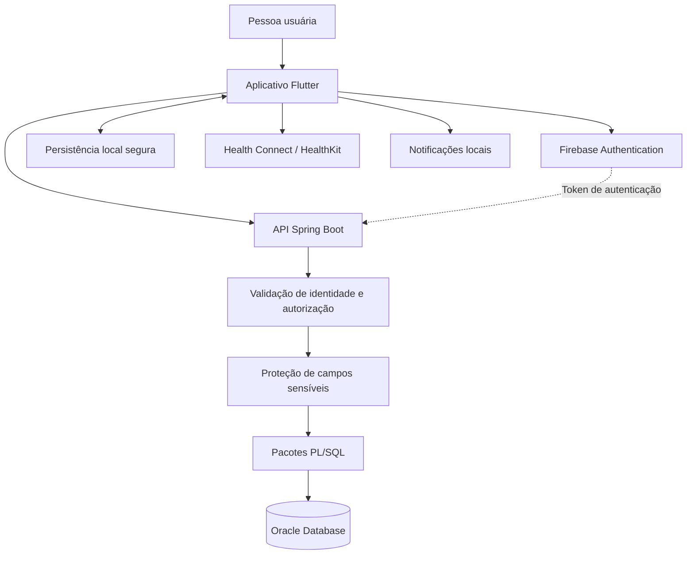

<div align="center">

  

  <h1>ELORA</h1>
  <p><strong>A inteligência que cuida antes que seja necessário.</strong></p>
  <p><em>Environment · Life · Orientation & Response</em></p>

  <p>
    
    
    
    
    
  </p>

  <p>
    <a href="#-sobre-o-projeto">Sobre</a> ·
    <a href="#-funcionalidades">Funcionalidades</a> ·
    <a href="#-arquitetura">Arquitetura</a> ·
    <a href="#-tecnologias">Tecnologias</a> ·
    <a href="#-execução-local">Execução</a>
  </p>

</div>

---

## 🍑 Sobre o projeto

A rotina de saúde reúne cada vez mais informações: indicadores registrados em dispositivos, medicamentos, hábitos, condições pessoais e dados sobre o ambiente. Porém, esses dados costumam ficar espalhados em diferentes aplicativos e fontes. Ter acesso a um número não significa, necessariamente, compreender o que ele representa ou saber como agir a partir dele.

O **ELORA** nasce para aproximar essas informações da vida cotidiana. É uma aplicação mobile voltada ao **letramento em saúde e ao cuidado preventivo contextual**, que organiza registros pessoais, apresenta explicações educativas e oferece orientações relacionadas à rotina e às condições ambientais.

A proposta é transformar informações isoladas em compreensão e próximos passos possíveis — respeitando a autonomia, as escolhas e a privacidade de cada pessoa.

> **Mais do que mostrar dados, o ELORA busca ajudar as pessoas a entender o que eles podem significar em seu cotidiano e quais cuidados podem considerar.**

### O significado de ELORA

| Pilar | Significado | O que representa |
|:--|:--|:--|
| **E — Environment** | Ambiente | As condições externas e suas transformações, e como elas se relacionam com a rotina. |
| **L — Life** | Vida | A pessoa, suas necessidades e sua autonomia no centro da experiência. |
| **ORA — Orientation & Response** | Orientação e resposta | A transformação de informações em compreensão e ações de cuidado. |

## ✦ Funcionalidades

### 1. Meu cuidado e letramento de indicadores

- Registro e consulta de hidratação, sono e frequência cardíaca.
- Exibição de unidades, datas dos registros e explicações educativas.
- Apresentação dos dados sem classificações ou conclusões clínicas.

### 2. Cuidado conectado e rotina pessoal

- Registro manual ou importação autorizada de indicadores compatíveis.
- Acompanhamentos opcionais relacionados a diabetes, hipertensão e ciclo menstrual.
- Organização de refeições, aplicações de insulina e lembretes de medicamentos.

### 3. Orientações contextuais e assistente

- Identificação de prioridades de cuidado a partir dos registros e configurações pessoais.
- Assistente educativa para dúvidas gerais e direcionamento aos recursos do aplicativo.
- Recomendações contextualizadas à rotina informada pela pessoa.

### 4. Rotina, ambiente e proteção

- Seleção do contexto do dia, como casa, computador, atendimento ou atividade externa.
- Sugestões de pausas e bem-estar.
- Guias educativos para calor intenso, enchentes e deslizamentos.
- Checklist pessoal de preparação e telefones oficiais de emergência.

### 5. Histórico de cuidado

- Organização cronológica de registros e ações.
- Consulta de informações por período.
- Relatórios para reflexão pessoal e apoio a conversas com profissionais de saúde.

## ◈ Arquitetura

O projeto separa a experiência mobile, os serviços de aplicação e a persistência dos dados. A autenticação é realizada pelo Firebase; a API Spring Boot valida a identidade recebida antes de executar operações no Oracle. As regras de negócio e validações de integridade são centralizadas em pacotes PL/SQL.



### Organização do repositório

```text
ELORA/
├── .github/
│   └── workflows/       # Workflows do GitHub
├── android/             # Projeto nativo Android
├── assets/
│   └── brand/           # Recursos visuais e logos
├── backend/             # API e serviços de backend
├── database/
│   └── oracle/          # Estruturas e rotinas Oracle / PL-SQL
├── lib/                 # Código-fonte Flutter/Dart
├── test/                # Testes automatizados
├── web/                 # Suporte à plataforma web do Flutter
├── analysis_options.yaml
├── pubspec.yaml
└── README.md
```

### Fluxo de uma operação protegida

1. A pessoa realiza uma ação no aplicativo, como registrar uma métrica ou confirmar um medicamento.
2. O Flutter envia a solicitação à API acompanhada do token Firebase.
3. A API valida o token e identifica o perfil pelo UID autenticado.
4. Quando aplicável, os campos sensíveis são protegidos antes da persistência.
5. Os pacotes PL/SQL verificam o perfil, a propriedade dos registros e as regras da operação.
6. O resultado retorna à API e, em seguida, ao aplicativo.

O aplicativo não acessa o banco Oracle diretamente nem executa comandos SQL livres. As operações são intermediadas pela API.

## 🧩 Tecnologias

| Camada | Tecnologia | Uso no projeto |
|:--|:--|:--|
| Aplicativo mobile | Flutter / Dart | Interface, navegação e lógica do aplicativo. |
| Autenticação | Firebase Authentication | Cadastro, login, sessão e validação de identidade. |
| API | Java / Spring Boot | Comunicação entre o aplicativo e a camada de dados. |
| Banco de dados | Oracle Database | Persistência relacional das informações. |
| Regras de dados | PL/SQL | Validações, operações transacionais e resumos. |
| Armazenamento local | Shared Preferences / Flutter Secure Storage | Preferências e dados locais, incluindo conteúdo sensível protegido. |
| Integração de saúde | Health Connect / HealthKit | Importação autorizada de métricas compatíveis. |
| Notificações | Flutter Local Notifications | Lembretes locais configurados pela pessoa usuária. |

### Segurança e privacidade

Como o ELORA lida com informações pessoais, privacidade e controle do usuário fazem parte das decisões de projeto.

- **Autenticação:** o perfil funcional é associado ao UID validado pelo Firebase.
- **Controle de acesso:** as operações verificam a propriedade dos registros antes de alterá-los.
- **Proteção de dados:** campos sensíveis podem ser cifrados pela API antes de serem enviados ao Oracle; o projeto descreve o uso de AES-256-GCM com contexto de usuário e campo.
- **Privilégio mínimo:** a camada de API utiliza um usuário de banco com permissões restritas às rotinas necessárias.
- **Consentimento:** importações de dados de saúde e notificações dependem de autorização ou ativação pela pessoa usuária.
- **Autonomia:** acompanhamentos opcionais podem ser configurados conforme a necessidade individual.

## 🚀 Execução local

### Pré-requisitos

- Flutter SDK compatível com a restrição definida em `pubspec.yaml` (`>=3.12.2 <4.0.0`).
- Dart SDK correspondente à versão do Flutter.
- Android Studio ou VS Code com as extensões Flutter e Dart.
- Configuração de um projeto Firebase para os recursos de autenticação.
- Para executar a arquitetura completa: ambiente da API e instância Oracle configurados conforme os arquivos do backend e do banco.

### Aplicativo Flutter

```bash
# Clone o repositório
git clone https://github.com/ELORA-Project/ELORA.git

# Entre na pasta
cd ELORA

# Instale as dependências
flutter pub get

# Verifique a configuração do ambiente
flutter doctor

# Execute os testes
flutter test

# Execute o aplicativo
flutter run
```

> **Configuração:** a execução com autenticação exige a configuração do Firebase para a plataforma escolhida. Consulte os arquivos de configuração do projeto antes de executar. A API e o Oracle também precisam estar disponíveis e configurados para os fluxos que dependem do backend.

## 🧪 Testes e qualidade

Os testes automatizados do aplicativo estão organizados no diretório `test/`. Para executá-los:

```bash
flutter test
```

Para verificar problemas estáticos e de estilo:

```bash
flutter analyze
```

## 🧭 Escopo e responsabilidade

O ELORA tem caráter **educativo e preventivo**. As informações e orientações apresentadas não substituem avaliação profissional, diagnóstico, prescrição ou atendimento de emergência. O aplicativo não deve ser utilizado como única fonte para decisões clínicas ou situações urgentes.

A pessoa usuária deve procurar os serviços de saúde ou emergência adequados sempre que necessário.

## 🌱 Próximos passos

O projeto possui espaço para evolução em áreas como:

- Ampliação das integrações com fontes autorizadas de dados.
- Aprimoramento das orientações contextuais e da personalização.
- Evolução dos recursos de acompanhamento e visualização histórica.
- Expansão dos testes e da documentação técnica.
- Melhorias contínuas de acessibilidade, experiência e proteção de dados.

## 🎓 Contexto acadêmico

O ELORA é desenvolvido como projeto acadêmico da **Global Solution — segundo semestre**, integrando conhecimentos de desenvolvimento mobile, engenharia de software, modelagem de dados, automação, segurança da informação e experiência do usuário.

---

<div align="center">

  <p><strong>ELORA</strong></p>
  <p><em>Cuidado que compreende. Tecnologia que orienta.</em></p>
  <sub>Feito com propósito, tecnologia e cuidado por: </sub>
  <p><sub>Manoela Oliveira, Paula Carregal, Pedro Santiago e Vanessa Fittipaldi 🍑</sub></p>

</div>
